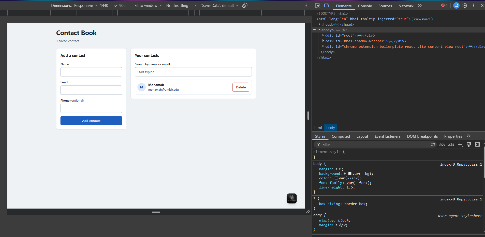
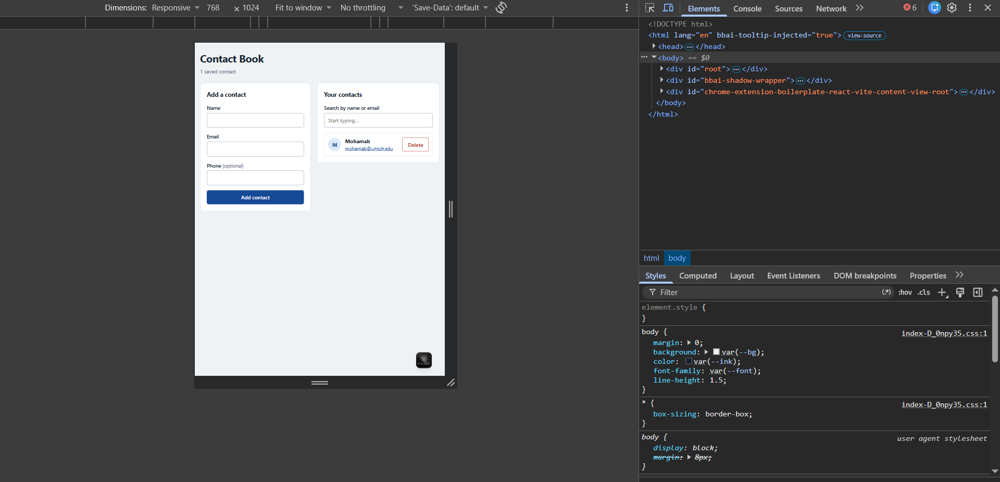

# Contact Book (React + Vite)

A single-page Contact Book built with React. Users can add, list, search and delete contacts. Data lives in memory for the session (no backend).

**Live site:** https://mohamab-j.github.io/contact-book2/
**Repository:** https://github.com/mohamab-j/contact-book2

## Features
- Controlled form (Name, Email, Phone) with client-side validation
  - Name and Email are required
  - Email must match a basic format (e.g. `name@example.com`)
  - Inline error messages that clear as the user corrects the field
- Contacts rendered with `map` using stable `id` keys (no array indexes)
- Case-insensitive search by name or email
- Delete a contact
- Conditional rendering:
  - Empty state: "No contacts yet. Add one above!"
  - No search results: "No matches found for ‘…’"
- Responsive layout (stacked on mobile, two columns from 768px) with visible focus states

## Tech Stack
- React 18
- Vite
- Plain CSS with CSS variables
- GitHub Actions + GitHub Pages for deployment

## Components
`App` (owns `contacts` and `filterText`) → `ContactForm`, `SearchBar`, `ContactList` → `ContactItem`

| Component | Responsibility |
|---|---|
| `App` | Single source of truth for `contacts` and `filterText`; add, delete and filter logic |
| `ContactForm` | Controlled inputs, validation, submits a new contact to `App` |
| `SearchBar` | Controlled search input that updates the filter text |
| `ContactList` | Renders the filtered list and the empty/no-match messages |
| `ContactItem` | One contact row with a Delete button |

## Project Structure
```
src/
├── App.jsx
├── main.jsx
├── index.css
└── components/
    ├── ContactForm.jsx
    ├── SearchBar.jsx
    ├── ContactList.jsx
    └── ContactItem.jsx
```

## Run Locally
```bash
npm install
npm run dev
```
Then open the local URL shown in the terminal.

## Screenshots

### Desktop (1280 × 800)


### Tablet (768 × 1024)


### Mobile (375 × 667)

